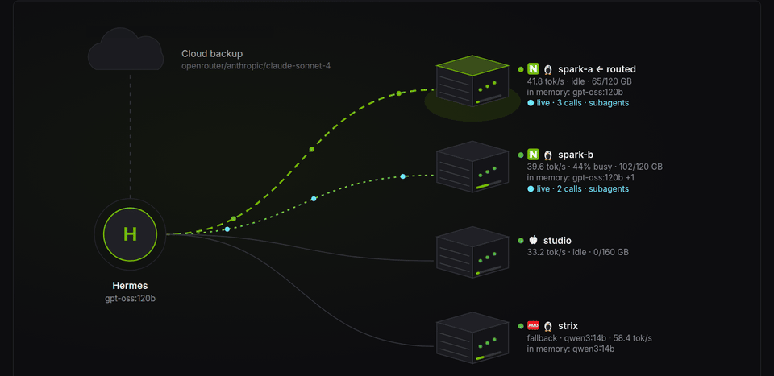
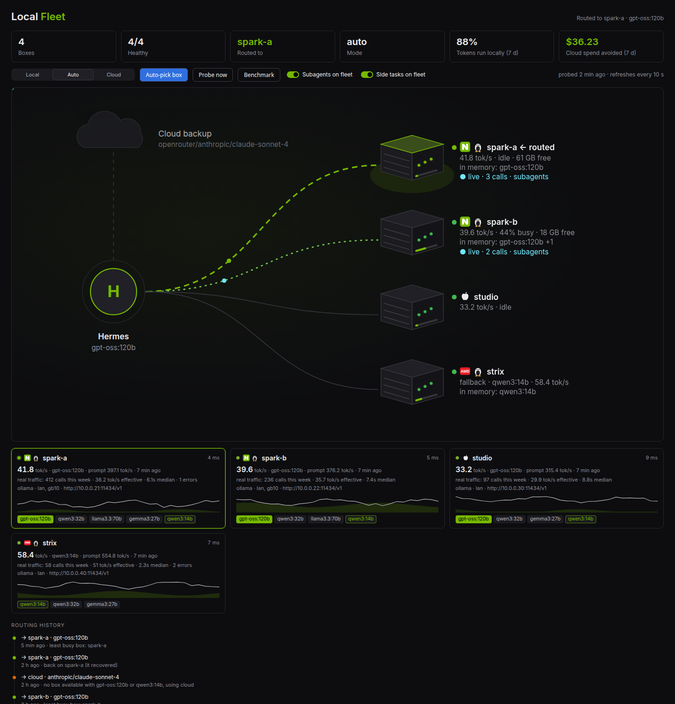
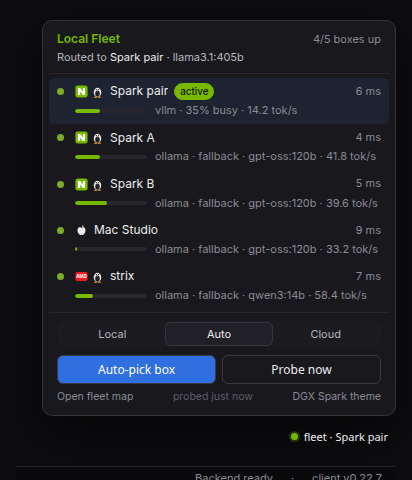

# Local Fleet (`local-fleet`)

**Route Hermes across a fleet of local inference boxes, and fall back to cloud only when you have to.**

Register your DGX Spark / GB10 boxes, Ollama hosts, vLLM servers or a LiteLLM gateway. local-fleet probes them, picks the least busy one that is up, makes it Hermes's primary model, and moves you to cloud when every box is down. When a box comes back it fails back to local. A Desktop status-bar chip shows where you are routed; `/fleet` and `hermes fleet` do the same from chat and the terminal.

```
$ hermes fleet status
  name         status    health                 kind              url
  spark-a      ok        41.8t/s 4ms load=0 free=61GB      ollama            http://10.0.0.21:11434/v1  ← active  (least busy)
  spark-b      ok        39.6t/s 5ms load=0.44 free=18GB   ollama            http://10.0.0.22:11434/v1
  studio       ok        33.2t/s 9ms load=0                ollama            http://10.0.0.30:11434/v1
  strix        ok        58.4t/s 7ms load=0.25             ollama            http://10.0.0.40:11434/v1  fallback · qwen3:14b

mode: auto
route: spark-a · gpt-oss:120b · http://10.0.0.21:11434/v1
why: staying on spark-a
```



| Fleet page | Status-bar chip |
|---|---|
|  |  |

*Screenshots use synthetic data (`scripts/screenshots/`): invented boxes, addresses and traffic.*

It is a standalone plugin, not a core change: it writes the same config keys you would set by hand, and leaves turn-level failover to Hermes's own `fallback_providers`.

## Install

```bash
hermes plugins install humedini/local-fleet
hermes plugins enable local-fleet
hermes fleet setup          # or the three commands below
```

Requires Hermes 0.22 or newer. One dependency: `httpx`.

```bash
hermes fleet add --name gx10 --url http://192.168.1.50:11434/v1 --kind ollama --label lan --capacity-gb 120
hermes fleet add --name spark2 --url http://192.168.1.51:11434/v1 --kind ollama
hermes fleet cloud openrouter anthropic/claude-sonnet-4     # the backup when every box is down
hermes fleet model gpt-oss:120b                             # optional: the model to run locally
hermes fleet use --best
```

## Modes

| Mode | Primary | When every local box is down | When a box recovers |
|---|---|---|---|
| `prefer-local` | the least busy box | cloud takes over | back to the least busy box |
| `auto` (default) | same as prefer-local | same | same |
| `prefer-cloud` | your cloud target | stays cloud | stays cloud; `hermes fleet use <box>` routes locally on demand |

`auto` and `prefer-local` behave the same today; `auto` is the name to use if you want future policy refinements (time of day, cost) to apply. Turn failback off with the `failback_enabled` setting to stay on cloud after a failover until you choose.

## How it picks a box

Every kind answers `GET {base}/models`, which decides up or down and gives latency. On top of that:

- **ollama**: `GET /api/ps`. Other models resident in memory count as load (0.25 each, or memory used divided by `--capacity-gb` when you give it), so a box that already holds the model you want looks freer and you skip a cold load.
- **vllm**: `GET /metrics`, using `vllm:gpu_cache_usage_perc` (or running requests).
- **litellm, openai-compatible**: latency only.

Lowest load wins, then preferred labels (`prefer_labels`), then most free memory, then latency, then name. If you set a local model (`hermes fleet model`), boxes that do not serve it are skipped. A box whose models answer but whose load endpoint fails is *degraded* and still routable.

### Fallback models

```bash
hermes fleet model gpt-oss:120b --fallback qwen3:14b
```

Boxes that cannot hold your main model can still help: with fallback models set, Local Fleet uses the least busy box with the main model; when no box has it, the least busy box with the first fallback model, and so on; cloud only after that. When a box with the main model comes back, Hermes moves back to it. Subagents and side tasks follow the same order. `--no-fallback` clears the list.

### Clusters

Several boxes linked to serve one big model (two DGX Sparks over their 200 GbE ConnectX-7 ports running vLLM with Ray, or llama.cpp RPC) still answer on one endpoint, the head node's. Register that endpoint as a cluster:

```bash
hermes fleet cluster add --name spark-pair --url http://10.0.0.21:8000/v1 --kind vllm \
    --members spark-a,spark-b --link "200 GbE"
```

It routes like any box (it can serve your main model while single boxes serve the fallback tiers). While it is busy, its members count as busy too, so single-box work does not land on memory the big model is using. On the Desktop map its members sit together in a rack, joined by the link, which pulses when Hermes is routed there; its card spans two columns with each member's memory. Local Fleet does not build clusters; it routes to and shows the ones you run.

### Display names

Every box keeps its short handle for commands and can have a display name for the Desktop: click the name on its card to edit (Enter saves, Esc cancels, empty goes back to the handle), or `hermes fleet set gx10 --title "Big Spark"`.

### Speed

`hermes fleet bench` runs a short generation (64 tokens) on each box and records tokens per second. For Ollama it uses Ollama's own timings (exact decode and prompt-processing speed); for other kinds it times a streamed reply. It only uses a model the box already has in memory, and skips busy boxes, so a bench never loads tens of GB behind your back; `--load` allows loading. `hermes fleet watch`, the start of a session and the Desktop's **Benchmark** button re-bench boxes whose figure is older than `bench_interval_s` (15 minutes; 0 turns it off). When two boxes are equally free, the one that was faster on the model being routed wins.

It does not flip-flop. The box Hermes is on is kept while it is up, unless another is clearly less busy (by more than `switch_margin`, default 0.25). `hermes fleet use gx10` keeps Hermes on that box while it is up; `use --best` or a mode change lets it choose again.

## What it changes in your Hermes config

Only these keys, through Hermes's own config writer (comments and formatting are kept):

- `model.provider`, `model.default`, `model.base_url`, `model.api_mode`, `model.key_env` — the primary. Local box: `provider: custom` with the box's base URL. Cloud: your `cloud_provider` and `cloud_model`. Other `model:` keys such as `context_length` are left alone.
- `fallback_providers` — your cloud target is appended once if it is not already there.

The first time it changes the primary it saves what you had. `hermes fleet restore` puts it back.

### Coordinating with `fallback_providers`

local-fleet chooses the **primary**. Hermes core owns the **per-turn** fallback chain: if the primary errors mid-turn, core moves to the next entry for that turn and returns to the primary on the next. local-fleet never runs a second chain; it only makes sure your cloud entry is on core's. The two together give you a fast, health-aware choice of box between turns and core's safety net within a turn.

### When a change takes effect

The gateway and Desktop rebuild the agent when the primary changes, so a new route applies from the **next message**. A classic CLI session that is already open keeps its model until the next session. This is deliberate: Hermes keeps a conversation on one model so its prompt cache stays valid.

## Operating the fleet

The Local Fleet page (and the CLI) is where you run the fleet day to day:

- **Why this box?** Click any box on the map, or *Why?* on its card, for the decision inspector: what was picked, the reason, and every box's verdict with the numbers behind it (load, latency, speed on this model, free memory) or why it was left out (down, wrong model, maintenance, rehearsal, verified unsuitable). `hermes fleet why`.
- **Flight recorder.** Health changes, routes Local Fleet configured, what Hermes actually **served** (from Hermes's own per-call hooks, so core fallback taking over within a turn shows up), rehearsals, maintenance and drift, in one timeline. `hermes fleet events`.
- **Rehearse an outage.** *Rehearse outage* on a card (or `hermes fleet rehearse gx10 --minutes 10`) leaves that box out of selection inside Local Fleet only: nothing is stopped on the box. It is labelled as a rehearsal everywhere and ends by itself.
- **Maintenance.** `hermes fleet maintenance gx10 on` leaves a box out of new selections until you turn it off. Requests already running on it finish; Local Fleet does not drain or stop anything.
- **Drift.** If something else changes what Local Fleet wrote (you, or another plugin editing `fallback_providers` or the side-task blocks), Local Fleet notices, says so, and does not overwrite it. *Reapply* takes routing back; *Stop managing* leaves the config exactly as it is. `hermes fleet drift [--reapply|--relinquish]`.
- **Readiness.** Per box and model: tool calling, vision and context size, with where each fact came from (Ollama's `/api/show` and `/api/ps`). A box is left out only on verified evidence: a model Ollama says cannot call tools, or a verified context below `min_context` (32k by default; Hermes's system prompt alone is ~15k tokens). Unknowns are shown as unknown. `hermes fleet readiness`.
- **Workload on the map.** Each box is labelled with what it is doing: chat, side tasks (titles, compression), subagents, rehearsal or maintenance.
- **Guided demo.** *Guided demo* walks the page in about 80 seconds: Why this box, a rehearsed outage, a hop to cloud, recovery, drift, readiness, savings and the doctor, each on the real panel with a caption. Steps that run rehearsals are tagged SIMULATION; Pause, Skip, Exit and Esc work at any point, and leaving ends the rehearsals it started. With routing off, the map shows where Local Fleet would send Hermes instead.
- **Rehearsal packs.** Named simulations above the flight recorder (and `hermes fleet pack <name>`): *Local A down* (the box Hermes is on), *Force cloud hop* (every box, so cloud, or a refusal with private inference on) and *Recover + drift* (the packs' rehearsals end and drift is checked). Each step leaves a marker in the recorder; *End packs* clears only the rehearsals the packs started. While any rehearsal runs, a switch skips the warm-up and keep-loaded never holds a model on the stand-in box.
- **Incident card.** *Copy incident card* (or `hermes fleet incident`) turns the last 24 hours of the recorder into Markdown for chat, Notion or a PR comment: window, simulated or real, the configured route, what actually served, and the events. Always scrubbed with the privacy filter, whatever the setting.
- **Savings receipt.** *Copy receipt* in the savings drawer (or `hermes fleet receipt [--window today|week] [--json]`): avoided API cost for today or the week with its baseline, rates, coverage and what is not counted. The week matches the page; with no price it says unavailable.
- **Cloud refused toast.** With private inference on, when Local Fleet refuses cloud because no box is up, Desktop says once which cloud route it held back, with a link to the recorder. Only when a cloud target is configured.
- **Doctor.** The *Doctor* button lists every check with a one-click fix (probe again, auto-pick, reapply, end a rehearsal) or the exact command to run: boxes down, keys missing, readiness, cloud backup, drift, private inference, plain HTTP to a public address, and whether a watch loop is really running (its heartbeat, not the doctor's own probe). `hermes fleet doctor`. It complements `hermes doctor` and `hermes plugins doctor`.

## Private inference

```bash
hermes fleet private on
```

Turning it on applies, and then checks against Hermes's config as it actually is:

| Path | What `private on` does | Checked every time |
|---|---|---|
| Primary | Local Fleet takes routing (even if it was off or paused) and puts Hermes on a box. With no box up it **refuses** cloud and keeps the primary on a registered box, so calls fail until one is back. | the primary's endpoint is a registered box |
| `fallback_providers` | cloud entries come off, kept and put back by `private off` | no entry outside the fleet; the legacy `fallback_model` key too |
| Side tasks | the ones Local Fleet manages lose their cloud `fallback_chain` and stay on their box while it is down | every `auxiliary.<task>` follows the primary (`auto`/`main`) or points at a box, with a local `fallback_chain` |
| Subagents | `delegation.backend` moves to `fleet`, which refuses cloud (the previous backend comes back on `off`, unless it was changed meanwhile) | the backend is `fleet` |

Hermes core resolves an `auto` side task as main provider, then the task's `fallback_chain`, then `fallback_providers`, and does not fall through to its built-in provider discovery once a main provider is set, which is why the table above is the whole model-call path.

What Local Fleet does not own it does not edit: a side task with its own `api_key`, a cloud entry someone adds back, a different delegation backend or a primary changed by hand (routing pauses rather than fight it). Each of those makes the status **not in force**, named in `hermes fleet private status`, the doctor, a banner on the Local Fleet page and the chip (*private not in force*). Local Fleet never reports it in force while one of them is there.

It is not air-gapping: tools such as web search, the browser, MCP servers, image generation and speech still use the internet, and so can anything that calls a model outside Hermes's routing (another plugin's own HTTP calls).

## Subagents on the fleet

```bash
hermes fleet delegate on        # delegation.backend: fleet
```

`delegate_task` subagents then run on your boxes: each task gets the least busy box, and the tasks of one fan-out take turns down the list from least busy, so four subagents land on four boxes and run in parallel. A task can say `where: cloud` (frontier model), `local` or `any` (the default: local when a box is up, else cloud); every local route keeps your cloud model as its fallback. Each result says which box ran it (`route.label`). Applies from each session's next session, or now with `/delegation fleet --now`; `hermes fleet delegate off` goes back to the default.

## Side tasks on the fleet

```bash
hermes fleet aux on                                  # titles + compression
hermes fleet aux on --tasks title_generation,compression,vision
hermes fleet aux off                                 # your own settings back
```

Hermes's auxiliary tasks run on the least busy box whatever the mode, with your cloud model as their fallback chain: cloud brain, local sidecar. They follow the least busy box as it changes, go back to your own settings when no box is healthy, and never touch the main conversation's prompt cache.

## Real traffic and spend avoided

Local Fleet listens to Hermes's own per-call observer hooks and keeps, per call, only the endpoint, model, token counts and duration (never the request or response) in `traffic.jsonl` in its data directory (about 6000 calls). From that:

```bash
hermes fleet stats
hermes fleet price                       # the rates in use and where they came from
```

There is nothing to set: the cloud backup's price comes from Hermes's own rate card (the one behind Hermes's cost display: official price snapshots, the OpenRouter models API, models.dev), looked up at most once a day, in US dollars. A subscription route such as `openai-codex` has no per-token price, so it uses the same model's API list price and says so. To use your own rates instead, `hermes fleet price 3 15 --currency GBP --model provider/model`; `hermes fleet price --auto` goes back to the rate card. Nothing is converted between currencies.

Amounts are formatted for your locale in the Desktop (symbol position, decimal comma, grouping) and with the currency's sign in the terminal.

`stats` shows calls, errors, effective tok/s (real calls with 32+ output tokens, prompt processing included) and median latency per box, how many of the week's tokens ran locally, and what those would have cost on cloud. The Desktop map lights the wire of every box taking calls right now, subagents included.

## Warm before switching

Before Hermes is switched to an Ollama box (Auto-pick box, failover, switching back), Local Fleet loads the model there and waits up to `warm_timeout_s` (120 s), so the first message after a switch does not pay for a cold load. `warm_before_switch: false` turns it off.

## Keep the model loaded

```bash
hermes fleet keep on
```

Ollama unloads a model after a few idle minutes, so the first message after a quiet spell waits for it to load again. With `keep on`, while Hermes is routed to an Ollama box the routed model stays in memory (refreshed whenever the plugin probes); when routing moves to another box, or you turn it off, the old box gets Ollama's normal idle timer back. It holds that model's memory for as long as you are routed there.

## Keeping it current

Routing is applied when you act (a command, `/fleet`, a Desktop button) and re-checked at the start of each new session. Switching between boxes, to cloud and back **continuously** needs `hermes fleet watch` running: the Desktop page shows stored status and does not probe or switch by itself. Within a single turn, Hermes's own `fallback_providers` already catches a failing call.

Routing is re-evaluated when you run a command, when a new session starts (in the background, at most once per `probe_interval_s`), and continuously with:

```bash
hermes fleet watch --interval 20      # foreground; Ctrl-C to stop
hermes fleet watch --once             # one tick, for cron or a systemd timer
```

To keep it running, a systemd user service is the simplest (with `loginctl enable-linger` so it survives logout):

```ini
# ~/.config/systemd/user/hermes-fleet-watch.service
[Unit]
Description=Local Fleet watch
After=network-online.target

[Service]
ExecStart=%h/.local/bin/hermes fleet watch --interval 30
Restart=on-failure
RestartSec=30

[Install]
WantedBy=default.target
```

`systemctl --user enable --now hermes-fleet-watch`. The doctor reports *Watch loop running* from the loop's own heartbeat. With keep-loaded on, a switch holds the model on the new box, so a laptop that sleeps moves its model onto the next box until it wakes.

## LiteLLM

Two supported setups:

1. **local-fleet picks the box** (the default story): register each box; the plugin chooses.
2. **LiteLLM balances**: register your LiteLLM proxy as one node with `--kind litellm`. local-fleet health-checks that gateway and fails over to cloud if it dies; balancing across boxes is LiteLLM's job.

local-fleet does not replace LiteLLM; it gives you health-aware routing without running one.

## Commands

| | |
|---|---|
| `hermes fleet setup` | guided first run |
| `hermes fleet add --name --url [--kind] [--label] [--api-key-env] [--capacity-gb]` | register a box |
| `hermes fleet rm / enable / disable <box>` | manage boxes |
| `hermes fleet list [--json]` | boxes and their last health |
| `hermes fleet status [--json]` | probe and show where it would route (changes nothing) |
| `hermes fleet use <box> \| --best` | switch Hermes to a box now, or to the least busy one |
| `hermes fleet mode [prefer-local\|prefer-cloud\|auto]` | show or set the mode |
| `hermes fleet cloud [<provider> <model>]` | show or set the cloud target |
| `hermes fleet model [<id>] [--fallback <id>]… [--no-fallback]` | the local model, and fallback models for smaller boxes |
| `hermes fleet watch [--interval s] [--once]` | keep routing current |
| `hermes fleet bench [<box>…] [--load]` | measure generation speed (tokens/sec) |
| `hermes fleet set <box> [--title] [--vendor] [--os] [--label] [--memory-gb] [--capacity-gb]` | display name, platform (Desktop icons), labels, total memory and memory for models |
| `hermes fleet cluster add\|rm …` | boxes linked to serve one big model behind one endpoint |
| `hermes fleet delegate on\|off\|status` | subagents on the fleet |
| `hermes fleet aux on\|off\|status [--tasks]` | side tasks on the fleet |
| `hermes fleet keep on\|off\|status` | keep the routed model in memory |
| `hermes fleet snapshot [--probe]` | the fleet's state as JSON, for dashboards and status screens (read-only) |
| `hermes fleet privacy on\|off` | hide box addresses in the Desktop and terminal (screen recordings) |
| `hermes fleet private on\|off\|status` | only your boxes; refuse rather than use cloud |
| `hermes fleet why` | the decision inspector: every box's verdict and score |
| `hermes fleet events [-n N]` | the flight recorder |
| `hermes fleet rehearse <box> [--minutes M] [--stop]` | simulated outage inside Local Fleet (nothing stopped) |
| `hermes fleet pack local-a-down\|force-cloud-hop\|recover-drift\|end` | rehearsal packs: named simulations, and ending the ones they started |
| `hermes fleet incident [--hours H] [--out file]` | the recorder as a scrubbed Markdown incident card |
| `hermes fleet receipt [--window today\|week] [--json]` | savings receipt with its working |
| `hermes fleet maintenance <box> on\|off` | leave a box out of new selections |
| `hermes fleet drift [--reapply\|--relinquish]` | what changed outside Local Fleet, and what to do about it |
| `hermes fleet readiness` | tools, vision and context per box and model, with evidence |
| `hermes fleet stats` | real traffic per box, local share, spend avoided |
| `hermes fleet price [<in> <out> [--currency CODE] [--model p/m]] [--auto]` | show the rates in use (looked up in Hermes's rate card by default), or set your own per million tokens |
| `hermes fleet endpoint` | the primary Hermes is using |
| `hermes fleet doctor` | readiness check |
| `hermes fleet restore` | put back your original primary |

In chat: `/fleet`, `/fleet list`, `/fleet mode auto`, `/fleet use best`, `/fleet use gx10`, `/fleet doctor`.

## Agent tools

- `fleet_status` — probe the fleet and report health, load, models and the route. Read-only.
- `fleet_list_nodes` — the registry with last health, no probing. Read-only.
- `fleet_pull_model` — pull a model onto one **Ollama** box through Ollama's pull API. The tool description asks the agent to confirm first.

The tools are hidden until at least one box is registered. There is no tool that runs commands on a box, and there never will be.

## Desktop

- **Local Fleet page** in the left sidebar: a live hardware map. Hermes is the hub; each box is drawn as a server with its health, load, free memory and the models in memory; packets flow along the line to the box you are routed to, or to the cloud backup on failover. Below it, a card per box with latency and load sparklines and its models (yours highlighted), and a timeline of routing changes. Mode switch, **Auto-pick box**, **Probe now** and **Benchmark** at the top.
- **Platform icons**: NVIDIA, AMD, Intel or Apple silicon, plus Linux or Windows, on the map, the cards and the panel. Set them with `hermes fleet add/set --vendor --os`; unset ones are guessed from the box name (gx10, spark, dgx → NVIDIA; mac, mini, studio → Apple; strix, ryzen → AMD) and say so on hover.
- **Status-bar chip**: `fleet · gx10` (green when routed locally), `fleet · cloud`, `fleet · all down`, or `fleet · 3/3 up` when the plugin is not routing. Click it for a compact panel with the same controls and a link to the page.
- **Command palette**: *Fleet: open the fleet map*, *Fleet: switch to the least busy box*, *Fleet: probe the fleet*, one entry per mode.
- **DGX Spark theme**: black and NVIDIA green, listed under themes, never selected for you.

The Desktop half talks to routes the plugin adds to the Hermes it is connected to (`/api/plugins/local-fleet/*`), so enable the plugin on that Hermes (local or remote) and restart its dashboard or gateway once.

## Keys

Boxes on your LAN or tailnet usually need none. For one that does, store the key as a Hermes secret and give its **name**:

```bash
hermes fleet add --name lab --url https://vllm.lab.example/v1 --kind vllm --api-key-env LAB_VLLM_KEY
```

The key is read with Hermes's secret resolver when that box is probed or used and sent to that box only. `fleet.json` holds the variable name, never the value, and the agent tools and Desktop never see either.

## Disclosures

- **Network**: HTTP requests go only to the base URLs you register (`/models`, plus `/api/ps` for Ollama or `/metrics` for vLLM), a 64-token generation per box for speed benches (`/api/generate` or `/chat/completions`), Ollama's `/api/show` for each of your models on each box at most hourly (readiness), and Ollama's `/api/pull` when the agent uses `fleet_pull_model`. The cloud price comes from Hermes's own rate-card lookup (`agent.usage_pricing`; it may fetch the OpenRouter models API or models.dev, cached by Hermes), at most daily and only when you have not set a price. Nothing else, no telemetry.
- **Files**: reads and writes `fleet.json`, `state.json`, `events.jsonl` (the flight recorder, last 400 events; addresses are masked before they are stored) and `traffic.jsonl` (per call: endpoint, model, token counts, duration; no content) in its own plugin data directory.
- **Config writes**: `model.provider`, `model.default`, `model.base_url`, `model.api_mode`, `model.key_env` (the original primary is saved; `restore` puts it back); one appended `fallback_providers` entry for your cloud model; on request `delegation.backend` (`delegate on/off`) and `auxiliary.<task>` `provider`, `model`, `base_url`, `fallback_chain` (`aux on/off`; the previous blocks come back on off, and a task holding its own `api_key` is never taken over); with `private on`, removal of non-local `fallback_providers` entries (put back on off), `delegation.backend: fleet` (previous backend put back on off) and side tasks without a cloud `fallback_chain`. Its own settings live under `plugins.entries.local-fleet.settings`.
- **Background work**: a short background probe when a session starts (at most once per `probe_interval_s`), with a speed bench when one is due. `hermes fleet watch` runs only when you start it. Observer hooks (`post_api_request`, `api_request_error`, `post_auxiliary_call`) append one line per call; `on_session_start` runs the background probe.
- **Privacy setting** (`hermes fleet privacy on`): every output path (CLI text and JSON, `/fleet`, the agent tools, the Desktop backend's responses and errors, the snapshot export) drops address fields and masks URLs, IP addresses, host:port, LAN and tailnet names and the boxes' own hosts in any text, probe errors included.
- **Credentials**: none stored. Optional per-box keys are read by env var name through Hermes's secret resolver.
- **Plain HTTP**: Ollama and vLLM usually serve plain HTTP. `doctor` warns if a box's URL is plain HTTP to a public address; keep boxes on your LAN, a tailnet or behind TLS.

## How it differs

**Your local inference fleet, operated from Hermes Desktop.** Not the first tool to pool local inference boxes, and not a better load balancer:

- **Closest peer: [Ollama Herd](https://github.com/geeks-accelerator/ollama-herd)**, which pools Ollama machines behind one endpoint. Choose Local Fleet when you live in Hermes: it routes Hermes itself, shows the fleet in Hermes Desktop, and explains every routing decision there.
- **Hermes keeps its own fallback chain.** Local Fleet chooses the primary between turns; core `fallback_providers` still handles a failure within a turn, and switching back is not unique to Local Fleet. No second fallback engine.
- **Not a proxy or load balancer.** For request-level balancing use LiteLLM (or Herd); Local Fleet can route to a LiteLLM gateway as one box.
- **A standalone plugin.** An in-tree `hermes dgx` proposal (hermes-agent PR #28009) was closed in favour of plugins; Local Fleet is that shape.
- **Not mixture-of-agents.** Plugins such as hermes-local-moa combine models for quality; Local Fleet picks where the one model runs.

## Known limitations (v0.3.0)

- Continuous switching needs `hermes fleet watch` running (see *Keeping it current*). The doctor judges that from the loop's own heartbeat.
- Private inference covers Hermes's model routing only (see its table); it is not air-gapping.
- State saved by v0.1.0 before the literal-key guard may still hold a side-task key in `state.json`; the doctor says so, and `hermes fleet aux off` puts it back in config and drops it. Nothing scrubs it silently.
- The savings baseline is your cloud backup at Hermes's rate-card price (USD), or the model you name with your own prices; prices entered before 0.2.0 without `--model` show the model as not recorded.
- If loading a model on the new box fails during a switch, the switch still happens and the toast says why; it does not yet try the next box instead.
- Load for Ollama boxes counts models in memory; it cannot see other GPU work (training jobs). Speeds are snapshots.
- Clusters are shown and routed, not created; the interconnect label is what you declare.
- On Windows the file lock only covers threads of one process.

## Not in scope

Starting or stopping inference servers, multi-box model sync, NVIDIA NIM management, mixture-of-agents. local-fleet routes between servers you already run.

## Develop

```bash
python -m venv .venv && .venv/bin/pip install httpx pyyaml pytest respx fastapi
.venv/bin/python -m pytest tests -q
hermes plugins validate . --install-deps
hermes plugins doctor . --ci
```

Try it without touching your real Hermes home:

```bash
export HERMES_HOME=$(mktemp -d)
mkdir -p $HERMES_HOME/plugins && ln -s "$PWD" $HERMES_HOME/plugins/local-fleet
hermes plugins enable local-fleet && hermes fleet setup
```

Catalog storyboard (three frames of the invented fleet: local, a simulated cloud hop, recovered, stamped with version and commit): `scripts/screenshots/storyboard.sh`, which writes `docs/img/storyboard-*.png`. The README images come from `scripts/screenshots/shoot.sh`. Neither reads a real fleet.

Tested with Hermes 0.22.7 on Linux against a GB10 box (ASUS Ascent GX10), an AMD Strix Halo laptop and an Apple silicon Mac, all running Ollama.

## Licence

MIT
